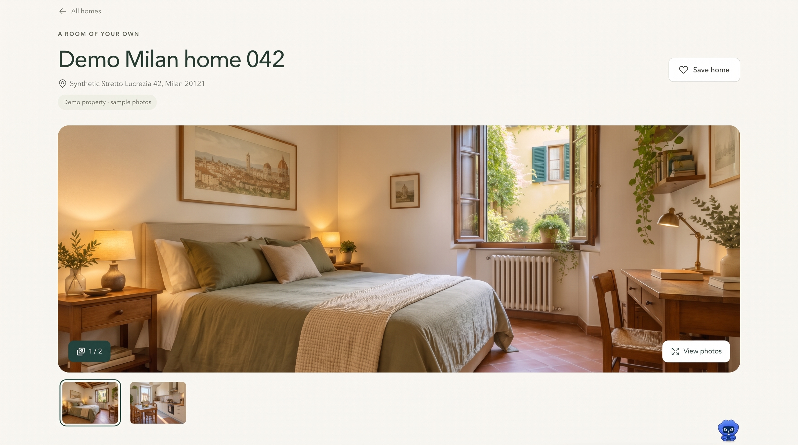

# Casa · Rental Platform

A full-stack portfolio project for finding rental homes and managing properties in Italy.

**[Visit the live demo →](https://casa.salehmmrezaei.com)**

Explore tenant, landlord and agency dashboards without a password. The demo uses fictional data, keeps rental records read-only and includes a clearly labelled simulated AI assistant.

## What you can explore

- **Tenants:** search homes, compare prices, and view applications, visits and saved listings.
- **Landlords:** explore property management, rental listings and occupancy.
- **Agencies:** review listings, applications, contracts and appointments.
- **Assistant & Blu:** ask guided rental questions and see relevant homes in chat.

Includes **300 sample properties** across Bologna, Milan, Rome and Florence.

View the property detail page

## Built with

**React · TypeScript · Python · FastAPI · PostgreSQL**

Vercel and Neon support the public demo. Docker supports local development and an alternative deployment. Tests use pytest, Vitest and Playwright.

## System design

## Run and learn more

[Local setup & tests](docs/development.md) · [Architecture](docs/architecture.md) · [Assistant & Blu](docs/assistant.md) · [Deployment](docs/vercel-neon.md)
