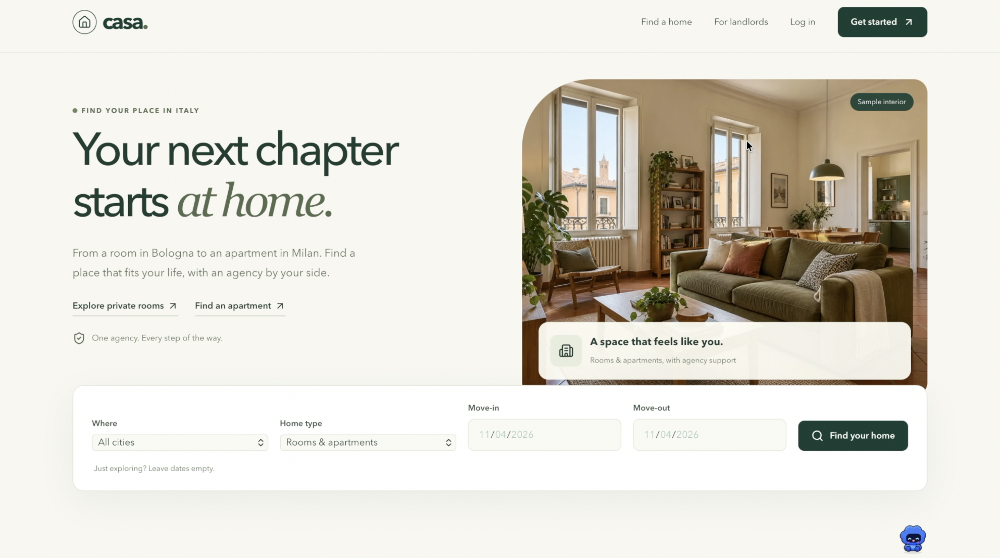
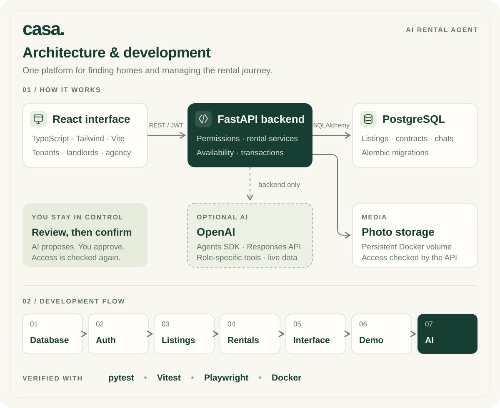

# Casa · AI Rental Agent

A rental platform for rooms and apartments in Italy, bringing home search, property management, and AI support into one place.



## What it does

- **Tenants:** find and save homes, request visits, apply for rentals, and contact the agency.
- **Landlords:** manage properties, listings, availability, and occupancy.
- **Agency staff:** review listings and applications, manage contracts, and coordinate visits.
- **AI assistance:** ask questions using live rental data and review proposed actions before confirming any change.

The demo includes **300 synthetic properties across Bologna, Milan, Rome, and Florence**, with sample photos and accounts for all three roles.

<details>
<summary>Preview the property detail page</summary>


</details>

## Architecture & development



## Tech stack

| Area | Technologies |
| --- | --- |
| Frontend | React, TypeScript, Tailwind CSS, Vite |
| Backend & data | Python, FastAPI, PostgreSQL, SQLAlchemy, Alembic |
| AI | Offline simulated demo; optional OpenAI Agents SDK / Responses API in normal environments |
| Tooling & testing | Docker Compose, pytest, Vitest, Playwright |

## Run locally

Requires Docker with Compose. Copy the configuration:

```sh
cp -n .env.example .env
```

In `.env`, set a database password and matching `DATABASE_URL`, a random `JWT_SECRET` of at least 32 bytes, and uncomment/set `DEMO_PASSWORD` (12–128 characters). Then start the app and load the demo:

```sh
docker compose up --build -d --wait
docker compose --profile demo run --build --rm seed
```

Open [Casa](http://localhost:5173). Sign in as `demo.tenant@example.com`, `demo.landlord@example.com`, or `demo.agency@example.com` using your `DEMO_PASSWORD`.

Live AI chat is optional: set the backend's `OPENAI_API_KEY` in `.env`. Browsing and rental workflows work without it.

[Development guide & tests](docs/development.md) · [Architecture details](docs/architecture.md) · [AI assistant design](docs/phase-7.md)

## Public portfolio demo

The separate production setup is prepared for `https://casa.salehmmrezaei.com`; deployment and DNS still require the owner's hosting configuration and live verification. Visitors can explore tenant, landlord and agency roles without a password. Shared fictional rental data stays read-only, with restrictions enforced by the backend even for direct API calls.

The **Simulated AI Assistant** uses guided, authorized queries against the synthetic dataset, displays listing cards and preserves Blu. It makes no external model requests and needs no API key. Visitor sessions and chat are temporary; normal local development retains the optional live integration and existing rental workflows.

Production uses an optimized React build, Caddy HTTPS, one FastAPI worker and private PostgreSQL 18 with persistent storage. See the [deployment guide](docs/deployment.md), [readiness and security report](docs/deployment-readiness.md) and [safe production env template](.env.production.example). The development Compose file remains separate.
