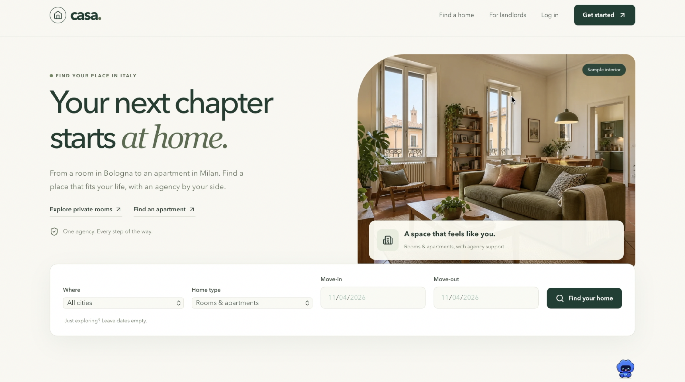
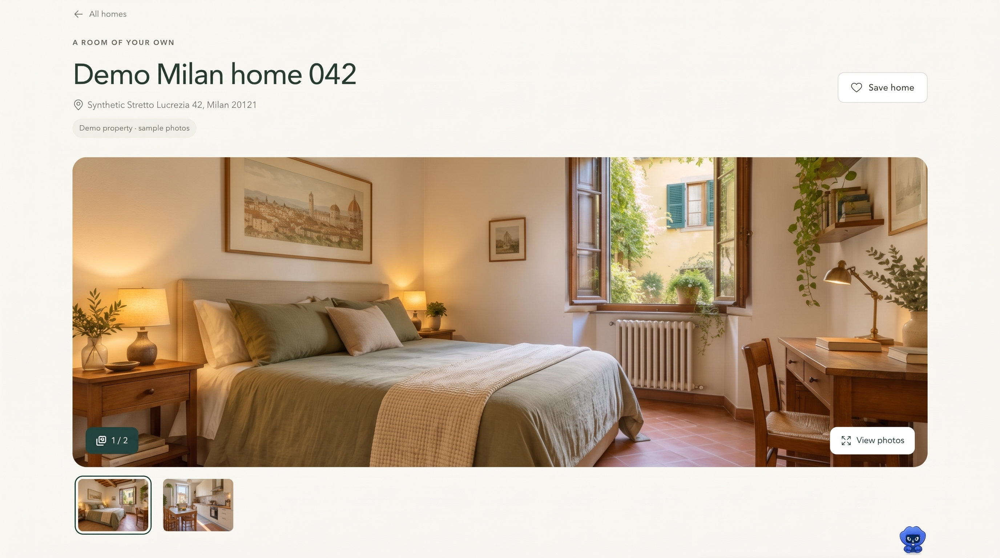
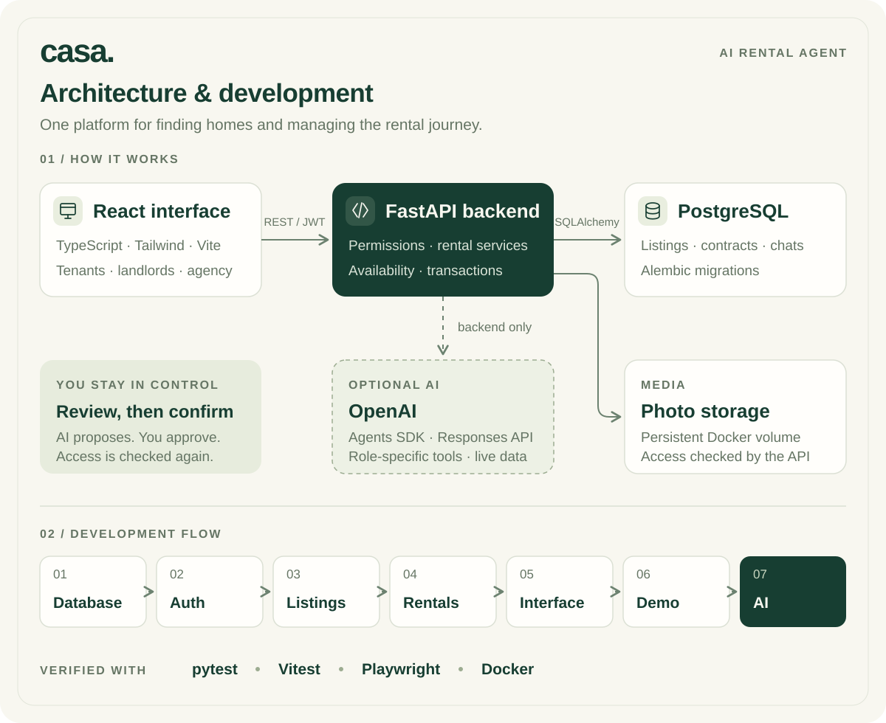

# Casa · AI Rental Agent

A rental platform for rooms and apartments in Italy, bringing home search, property management, and AI support into one place.



## What it does

- **Tenants:** find and save homes, request visits, apply for rentals, and contact the agency.
- **Landlords:** manage properties, listings, availability, and occupancy.
- **Agency staff:** review listings and applications, manage contracts, and coordinate visits.
- **AI assistance:** ask questions using live rental data and review proposed actions before confirming any change.

The demo includes **300 synthetic properties across Bologna, Milan, Rome, and Florence**, with sample photos and accounts for all three roles.

<details>
<summary>Preview the property detail page</summary>



</details>

## Architecture & development



## Tech stack

| Area | Technologies |
| --- | --- |
| Frontend | React, TypeScript, Tailwind CSS, Vite |
| Backend & data | Python, FastAPI, PostgreSQL, SQLAlchemy, Alembic |
| AI | OpenAI Agents SDK, Responses API |
| Tooling & testing | Docker Compose, pytest, Vitest, Playwright |

## Run locally

Requires Docker with Compose. Copy the configuration:

```sh
cp -n .env.example .env
```

In `.env`, set a database password and matching `DATABASE_URL`, a random `JWT_SECRET` of at least 32 bytes, and uncomment/set `DEMO_PASSWORD` (12–128 characters). Then start the app and load the demo:

```sh
docker compose up --build -d --wait
docker compose --profile demo run --build --rm seed
```

Open [Casa](http://localhost:5173). Sign in as `demo.tenant@example.com`, `demo.landlord@example.com`, or `demo.agency@example.com` using your `DEMO_PASSWORD`.

Live AI chat is optional: set the backend's `OPENAI_API_KEY` in `.env`. Browsing and rental workflows work without it.

[Development guide & tests](docs/development.md) · [Architecture details](docs/architecture.md) · [AI assistant design](docs/phase-7.md)
