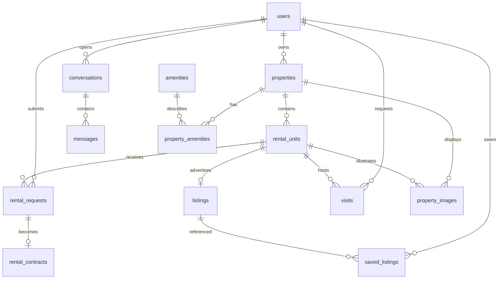

# Architecture and development plan

## Application boundaries

React + Vite uses TypeScript, Tailwind, React Router and a typed API client,
implemented in Phase 5. FastAPI exposes
versioned REST endpoints; routers validate Pydantic inputs and delegate to services.
Services own authorization, state transitions, and transaction boundaries;
repositories encapsulate queries. PostgreSQL is the source of truth. Alembic
creates the schema; the application never calls `create_all` at startup.

SQLAlchemy uses UUID identifiers, exact decimal EUR amounts, UTC-capable timestamps,
and foreign keys with restricted deletion for business records. Amenities are
normalized, image records contain storage keys rather than arbitrary remote URLs,
and saved listings have a tenant/listing uniqueness constraint. Availability and
occupancy are derived from dated contracts, never a mutable occupied flag.

## Relational schema

| Table | Relationships / purpose |
| --- | --- |
| users | Unique normalized email, password hash, tenant/landlord/admin role |
| properties | Many properties belong to one landlord; synthetic address marker |
| rental_units | Many rooms plus at most one entire apartment per property |
| listings | One listing per unit; availability window and agency review status |
| rental_requests | Tenant applications for unit and half-open date interval |
| rental_contracts | One contract per application; exact applicant/unit/date match |
| conversations | Private tenant-to-agency conversation |
| messages | Conversation messages by its tenant or agency admins only |
| visits | Tenant and unit, requested and scheduled times, lifecycle status |
| property_images | Property image; optional room constrained to the same property |
| amenities | Reusable amenity vocabulary |
| property_amenities | Property/amenity many-to-many association |
| saved_listings | Unique tenant/listing saved item |
| assistant_threads | Tenant-owned AI chat with bounded server-side model history |
| assistant_messages | User/assistant text and database-verified listing references |
| assistant_actions | Tenant-scoped proposed tasks, expiry and atomic confirmation results |

## Database business rules

- Composite role foreign keys require landlord owners and tenant applicants.
- Ownership and unit property/kind cannot be reassigned. A dedicated audited
  ownership-transfer feature would need an explicit later migration.
- Prices are positive, deposits nonnegative, intervals nonempty. Intervals use
  `[start, end)` so checkout and next check-in can share a date.
- Contracts require an approved application. The application parties, unit, and
  dates must match through a composite foreign key. Contract parties and dates
  are immutable; changes require cancellation and a replacement application.
- Each contract write updates the parent property's booking revision before
  checking conflicts. All room/apartment bookings within that property serialize.
  A VOLATILE trigger sees freshly committed contracts under READ COMMITTED;
  stronger isolation aborts stale writers with serialization failures. Services
  must retry complete transactions on SQLSTATE 40001/40P01 (Phase 4).
- Same-unit overlap and apartment/room overlap are rejected with SQLSTATE 23P01.
  Different rooms may overlap. All noncancelled records reserve their historical
  interval, including completed and terminated contracts. Phase 4's immutable
  effective termination date releases the unused portion of an ended lease.
- Listing availability windows are checked by the approval service in Phase 4,
  together with publication state and authenticated permissions. The database
  foundation prevents rental conflicts even for direct SQL writes.
- Message authors must be admins or the conversation's own tenant. Endpoint
  authentication and read privacy remain Phase 2/4 responsibilities.
- Business history uses restricted deletion; saved listings and amenity joins may
  cascade. ORM and database updates refresh `updated_at`.

The parent-row update is deliberate: a plain row lock is insufficient for stale
snapshots at stronger isolation. See [PostgreSQL consistency checks](https://www.postgresql.org/docs/current/applevel-consistency.html)
and [function visibility](https://www.postgresql.org/docs/current/spi-visibility.html).

## Status transitions

Database checks reject unknown states and triggers reject illegal updates.
Inserts may specify any recognized state for controlled imports; public
APIs enforce initial states and agency permissions.

- Listings: draft/rejected → submitted → approved/rejected;
  approved/unpublished → published → unpublished.
- Applications: submitted → reviewing/rejected/withdrawn;
  reviewing → approved/rejected/withdrawn.
- Visits: requested → scheduled/rejected/cancelled;
  scheduled → completed/cancelled.
- Contracts: confirmed → active/cancelled; active → completed/terminated.

## REST endpoint plan

Health endpoints were implemented in Phase 1. Phase 2 adds registration, login,
logout, profiles, password changes and an admin user directory. Phase 3 adds inventory CRUD, image management, listing moderation/search and live
availability. Phase 4 implements applications, contracts, visits, messaging, saves,
account management and reporting. See the phase reports for exact implemented routes.
Collections use bounded page/page_size and allowlisted sorting/filtering.
Errors use the shared envelope implemented in Phase 2.

| Phase | Routes | Access |
| --- | --- | --- |
| 1 | GET /api/v1/health/live, /health/ready | Public operational checks |
| 2 | POST /auth/register, /auth/login; GET/PATCH /users/me | Public auth; authenticated profile |
| 3 | GET/POST /properties; GET/PATCH /properties/{id} | Owners and agency; restricted reads |
| 3 | GET/POST /properties/{id}/units; PATCH /units/{id} | Owners and agency |
| 3 | POST/DELETE /properties/{id}/images | Owners and agency; validated uploads |
| 3 | GET /listings, /listings/{id}; POST /units/{id}/listing | Public published search; owner creation |
| 3 | POST /listings/{id}/submit; PATCH /admin/listings/{id}/status | Owner submit; agency moderation |
| 4 | GET/POST /applications; POST /admin/applications/{id}/approve or /reject | Tenant own; agency decisions |
| 4 | GET /contracts; PATCH /admin/contracts/{id} | Tenant own, redacted owner, agency |
| 4 | GET/POST /visits; PATCH /admin/visits/{id} | Tenant own; agency scheduling |
| 4 | GET/POST /conversations; GET/POST /conversations/{id}/messages | Own tenant and agency only |
| 4 | GET/PATCH /admin/users/{id}; GET /admin/users | Agency only |
| 4 | GET /dashboard/statistics; GET/POST/DELETE /saved-listings | Role-scoped statistics; tenant saves |
| 7 | POST /assistant/chat; POST /assistant/actions/{id}/confirm | Tenant-scoped tools and explicit action confirmation |
| 7 | GET /assistant/status, /assistant/threads, /assistant/threads/{id}; POST /assistant/actions/{id}/cancel | Authenticated tenant's own chats and actions |

Tenant registration cannot choose admin privileges. Owner queries must always
scope by authenticated landlord ID. Contract approval locks the property and application,
validate availability, approve it and insert its contract in one transaction.
Landlord contract responses omit tenant private fields. Admin account
provisioning uses the separate development/bootstrap command.

## Roadmap and acceptance gates

1. Database foundation: models, immutable migration, Docker, health checks,
   PostgreSQL constraints and concurrent-write tests. Stop for user approval.
2. Authentication: password hashing, JWT, profile schemas, permissions, tests.
3. Inventory: ownership-safe CRUD, rooms, upload validation, moderation, search.
4. Rental operations: transactional approvals, contracts, visits, private messages,
   live availability and occupancy, end-to-end authorization/conflict tests.
5. Frontend: TypeScript/Tailwind conversion, public pages and three dashboards,
   backend-connected forms, persistent auth, Vitest/RTL tests.
6. Fake data/integration: Faker 100 landlords, 200 tenants, 300 properties across
   Bologna/Milan/Rome/Florence; safe demo accounts and valid rental histories;
   Docker startup and primary user journeys. Implemented; see [Phase 6](phase-6.md).
7. AI: only after core acceptance passes, integrate OpenAI API and Agents SDK;
   current backend data, tenant authorization, explicit mutation confirmations,
   backend-only keys, tool tests and logging. Implemented; see [Phase 7](phase-7.md).

No real payments or external email are implemented. Phase 7 OpenAI requests are
optional and use backend-only credentials; automated verification uses an offline
model. Tenant registration remains separate from operator API configuration.

Phase 6 uses a pinned Faker version with an independently seeded Italian locale,
stable UUIDs and one PostgreSQL transaction. A transaction advisory lock serializes
seed commands. Controlled history imports keep constraints/triggers active; only
the import may insert historical final states. Dates are relative to Europe/Rome
today or an explicit initial anchor. Only three demo accounts share the local
operator's password; all other accounts have independently generated credentials.
The seed runs through an opt-in Compose profile or local CLI and never on startup.
Separate disposable databases and Docker services support repeatable verification.

## Phase 2 authentication decisions

- Argon2id hashes use 64 MiB memory, three iterations and four lanes, with independent
  salts. Successful logins upgrade hashes when parameters change. Missing-user logins
  verify against a dummy hash; wrong-password and inactive-account errors are generic.
  See the [argon2-cffi API](https://argon2-cffi.readthedocs.io/en/stable/api.html).
- JWTs pin HS256 and validate signature, expiry, issued-at/not-before, issuer and
  audience. Subject and token ID are UUIDs; access type and integer token version
  are validated. All these claims are required. See [PyJWT usage](https://pyjwt.readthedocs.io/en/latest/usage.html).
- The signing key is backend-only, generated locally and required at application
  startup. Database migrations do not require a signing key. No token embeds
  passwords, email addresses or authorization roles.
- Every request reads active state, token version and role from PostgreSQL. Updating
  token_version revokes all that user's tokens persistently across server restarts.
  Profile/password/logout writes lock the user row and recheck the authenticated
  version before mutating, preventing stale concurrent credential changes.
- Duplicate emails rely on the PostgreSQL unique constraint and are converted to
  HTTP 409 with transaction rollback. Self-service models forbid privileged fields.
- User profiles are self/admin-only. Property/unit guards scope SQL queries by owner
  before returning data. Tenant or other-owner requests get the same 404 as missing
  resources. The guards are wired into the Phase 3 inventory routers.
- Admin provisioning is a local password-prompt command, never public registration
  and never a promotion of an existing account. The new read-only admin directory
  exposes safe paginated user profiles.
- Validation and database errors omit input values and SQL parameters. A bounded
  IP-based local auth limiter supplements deployment-wide gateway limits.

## Phase 3 inventory decisions

- Private inventory routes scope by landlord or admin; public listing serializers
  omit ownership, moderation notes, storage keys and rental parties. Scoped queries
  hide inaccessible unit/listing existence as well as their contents.
- Property mutations and listing review transitions acquire the same property row
  lock before checking review state. Property/unit/image content freezes during
  review or publication; withdrawal returns unpublished reviews to draft. This
  prevents a concurrent edit from bypassing an agency decision. Migration 0003
  extends only listing transitions; earlier revisions stay frozen.
- Search and availability use a shared correlated EXISTS predicate over contracts
  and their units. Matching property, overlapping half-open dates, and same-unit or
  apartment/room relationships produce a conflict. Separate rooms remain independent.
  [SQLAlchemy correlated queries](https://docs.sqlalchemy.org/en/20/tutorial/data_select.html)
  describe the query constructs used. No mutable occupied flag was added.
- Search without dates exposes future inventory with available_now; dated search
  requires both endpoints and covers the complete listing window. Occupancy uses
  Europe/Rome business dates and includes apartment/room conflicts.
- Amenity names are normalized and associated through the existing junction table.
  Property/unit deletions respect business-history foreign keys and roll back on
  conflicts. Draft listings, saved-listing references and images are removed only
  when an inventory deletion can complete.
- Pillow validates dimensions, format and single-frame content, then re-encodes
  independent pixel data without user metadata. Request and file sizes are bounded.
  [Pillow image security](https://pillow.readthedocs.io/en/stable/handbook/security.html)
  documents decompression-bomb protections. Files have server-generated keys,
  permission-aware serving, no-store/nosniff headers and a persistent Docker volume.
- Local filesystem writes cannot share PostgreSQL's transaction: failed inserts
  remove new files, successful metadata deletes trigger file cleanup, and crash
  or cleanup leftovers require reconciliation. Unreferenced files are never public.

## Phase 4 rental operation decisions

- Every new mutation runs in an independent transaction with fresh account and
  role checks. PostgreSQL serialization failures (`40001`) and deadlocks (`40P01`)
  roll back and retry the **entire** operation, at most three attempts.
  Exclusion, uniqueness and lifecycle conflicts return sanitized HTTP 409 errors.
  See [PostgreSQL retry guidance](https://www.postgresql.org/docs/16/mvcc-serialization-failure-handling.html).
- Booking writes take the property lock before the application/contract/visit lock
  and update `booking_revision`. Listing changes share that property lock.
  Approval rechecks publication, the complete availability window and apartment/room
  conflicts, then approves and inserts the contract atomically. The contract trigger
  remains a final defense, including against direct database writes.
- Contracts retain their original dates and parties. `terminated_on` is an
  immutable effective end, recorded only when terminating an active lease; all
  availability and reports use it. Cancelled contracts reserve no dates. Legacy
  terminated rows without an effective end retain their original interval.
- Visits store a UTC start/end, duration and assigned active agency administrator.
  GiST exclusion constraints prevent simultaneous appointments for one staff
  member or tenant, including across properties. Adjacent visits are allowed.
  See [PostgreSQL ranges and exclusion constraints](https://www.postgresql.org/docs/17/rangetypes.html).
- Conversations belong to one tenant and the agency. Read receipts mark only
  incoming messages and are shared across agency staff. Sent content and identity
  are immutable. Tenant responses identify the sender as tenant/agency without
  exposing staff IDs; landlords cannot access correspondence or applications.
- Reports count rooms as physical units when a property has room inventory; the
  apartment is an alternative booking mode. A whole-apartment lease occupies all
  rooms and contributes its rent once. `contracted_monthly_rent` sums current
  contracts and represents neither collected payments nor payment processing.
- Admin edits allow name, email and activation changes; email/activation changes
  revoke tokens. Roles/passwords cannot be edited through this endpoint. Active
  admins lock in stable order and cannot deactivate themselves.

Exact endpoints, accepted transitions and operational limitations are documented
in [Phase 4](phase-4.md).

## Phase 5 frontend decisions

The React starter is replaced by strict TypeScript, Tailwind and React Router.
Public listing pages and three role workspaces share form, pagination, dialog,
loading/error and listing components. All product state lives in the existing
FastAPI/PostgreSQL services; frontend tests alone mock fetch.

The HTTP client sends revocable bearer tokens. Persistence stores only token/expiry,
and session restoration calls the backend profile endpoint before exposing a
private route. Expired/revoked sessions clear, tab changes synchronize, old reads
abort, and resource identities include the authenticated account.

Same-origin `/api` proxying avoids separate browser configuration for local/Docker
development. Private images use authenticated blobs with URL cleanup. Scoped
application/visit responses gain rental display names without a migration or
changes to permissions. See [Phase 5](phase-5.md) for exact routes and checks.
