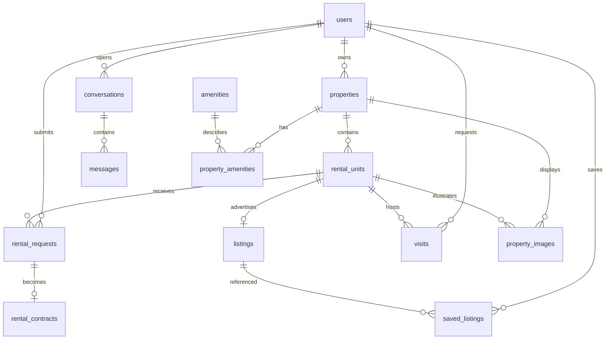

# Architecture and development plan

## Application boundaries

React + Vite will use TypeScript, Tailwind, React Router, and a typed API client in
Phase 5. The existing JavaScript starter is preserved until then. FastAPI exposes
versioned REST endpoints; routers validate Pydantic inputs and delegate to services.
Services own authorization, state transitions, and transaction boundaries;
repositories encapsulate queries. PostgreSQL is the source of truth. Alembic
creates the schema; the application never calls `create_all` at startup.

SQLAlchemy uses UUID identifiers, exact decimal EUR amounts, UTC-capable timestamps,
and foreign keys with restricted deletion for business records. Amenities are
normalized, image records contain storage keys rather than arbitrary remote URLs,
and saved listings have a tenant/listing uniqueness constraint. Availability and
occupancy are derived from dated contracts, never a mutable occupied flag.

## Relational schema

| Table | Relationships / purpose |
| --- | --- |
| users | Unique normalized email, password hash, tenant/landlord/admin role |
| properties | Many properties belong to one landlord; synthetic address marker |
| rental_units | Many rooms plus at most one entire apartment per property |
| listings | One listing per unit; availability window and agency review status |
| rental_requests | Tenant applications for unit and half-open date interval |
| rental_contracts | One contract per application; exact applicant/unit/date match |
| conversations | Private tenant-to-agency conversation |
| messages | Conversation messages by its tenant or agency admins only |
| visits | Tenant and unit, requested and scheduled times, lifecycle status |
| property_images | Property image; optional room constrained to the same property |
| amenities | Reusable amenity vocabulary |
| property_amenities | Property/amenity many-to-many association |
| saved_listings | Unique tenant/listing saved item |

## Database business rules

- Composite role foreign keys require landlord owners and tenant applicants.
- Ownership and unit property/kind cannot be reassigned. A dedicated audited
  ownership-transfer feature would need an explicit later migration.
- Prices are positive, deposits nonnegative, intervals nonempty. Intervals use
  `[start, end)` so checkout and next check-in can share a date.
- Contracts require an approved application. The application parties, unit, and
  dates must match through a composite foreign key. Contract parties and dates
  are immutable; changes require cancellation and a replacement application.
- Each contract write updates the parent property's booking revision before
  checking conflicts. All room/apartment bookings within that property serialize.
  A VOLATILE trigger sees freshly committed contracts under READ COMMITTED;
  stronger isolation aborts stale writers with serialization failures. Services
  must retry complete transactions on SQLSTATE 40001/40P01 (Phase 4).
- Same-unit overlap and apartment/room overlap are rejected with SQLSTATE 23P01.
  Different rooms may overlap. All noncancelled records reserve their historical
  interval, including completed and terminated contracts. Early termination will
  need an effective-date design in Phase 4 before releasing unused future dates.
- Listing availability windows will be checked by the approval service in Phase 4,
  together with publication state and authenticated permissions. The database
  foundation prevents rental conflicts even for direct SQL writes.
- Message authors must be admins or the conversation's own tenant. Endpoint
  authentication and read privacy remain Phase 2/4 responsibilities.
- Business history uses restricted deletion; saved listings and amenity joins may
  cascade. ORM and database updates refresh `updated_at`.

The parent-row update is deliberate: a plain row lock is insufficient for stale
snapshots at stronger isolation. See [PostgreSQL consistency checks](https://www.postgresql.org/docs/current/applevel-consistency.html)
and [function visibility](https://www.postgresql.org/docs/current/spi-visibility.html).

## Status transitions

Database checks reject unknown states and triggers reject illegal updates.
Inserts may specify any recognized state for controlled imports; future public
APIs must enforce initial states and agency permissions.

- Listings: draft/rejected → submitted → approved/rejected;
  approved/unpublished → published → unpublished.
- Applications: submitted → reviewing/rejected/withdrawn;
  reviewing → approved/rejected/withdrawn.
- Visits: requested → scheduled/rejected/cancelled;
  scheduled → completed/cancelled.
- Contracts: confirmed → active/cancelled; active → completed/terminated.

## REST endpoint plan

Health endpoints were implemented in Phase 1. Phase 2 adds registration, login,
logout, profiles, password changes and an admin user directory. Inventory and rental
operation routes remain planned. See the Phase 2 report for exact implemented routes.
Collections will use bounded page/page_size and allowlisted sorting/filtering.
Errors will use a shared envelope in Phase 2.

| Phase | Routes | Access |
| --- | --- | --- |
| 1 | GET /api/v1/health/live, /health/ready | Public operational checks |
| 2 | POST /auth/register, /auth/login; GET/PATCH /users/me | Public auth; authenticated profile |
| 3 | GET/POST /properties; GET/PATCH /properties/{id} | Owners and agency; restricted reads |
| 3 | GET/POST /properties/{id}/units; PATCH /units/{id} | Owners and agency |
| 3 | POST/DELETE /properties/{id}/images | Owners and agency; validated uploads |
| 3 | GET /listings, /listings/{id}; POST /units/{id}/listing | Public published search; owner creation |
| 3 | POST /listings/{id}/submit; PATCH /admin/listings/{id}/status | Owner submit; agency moderation |
| 4 | GET/POST /applications; POST /admin/applications/{id}/approve or /reject | Tenant own; agency decisions |
| 4 | GET /contracts; PATCH /admin/contracts/{id} | Tenant own, redacted owner, agency |
| 4 | GET/POST /visits; PATCH /visits/{id} | Tenant own; agency scheduling |
| 4 | GET/POST /conversations; GET/POST /conversations/{id}/messages | Own tenant and agency only |
| 4 | GET/PATCH /admin/users/{id}; GET /admin/users | Agency only |
| 4 | GET /dashboard/statistics; GET/POST/DELETE /saved-listings | Role-scoped statistics; tenant saves |
| 7 | POST /assistant/chat; POST /assistant/actions/{id}/confirm | Tenant-scoped tools and explicit action confirmation |

Tenant registration cannot choose admin privileges. Owner queries must always
scope by authenticated landlord ID. Contract approval will lock the application,
validate availability, approve it and insert its contract in one transaction.
Landlord contract responses must omit tenant private fields. Admin account
provisioning will use a separate development/bootstrap command.

## Roadmap and acceptance gates

1. Database foundation: models, immutable migration, Docker, health checks,
   PostgreSQL constraints and concurrent-write tests. Stop for user approval.
2. Authentication: password hashing, JWT, profile schemas, permissions, tests.
3. Inventory: ownership-safe CRUD, rooms, upload validation, moderation, search.
4. Rental operations: transactional approvals, contracts, visits, private messages,
   live availability and occupancy, end-to-end authorization/conflict tests.
5. Frontend: TypeScript/Tailwind conversion, public pages and three dashboards,
   backend-connected forms, persistent auth, Vitest/RTL tests.
6. Fake data/integration: Faker 100 landlords, 200 tenants, 300 properties across
   Bologna/Milan/Rome/Florence; safe demo accounts and valid rental histories;
   Docker startup and primary user journeys.
7. AI: only after core acceptance passes, integrate OpenAI API and Agents SDK;
   current backend data, tenant authorization, explicit mutation confirmations,
   backend-only keys, tool tests and logging.

No real payments, external messaging, real personal records, or AI calls belong
in this phase. Model packages for later phases are intentionally reserved.

## Phase 2 authentication decisions

- Argon2id hashes use 64 MiB memory, three iterations and four lanes, with independent
  salts. Successful logins upgrade hashes when parameters change. Missing-user logins
  verify against a dummy hash; wrong-password and inactive-account errors are generic.
  See the [argon2-cffi API](https://argon2-cffi.readthedocs.io/en/stable/api.html).
- JWTs pin HS256 and validate signature, expiry, issued-at/not-before, issuer and
  audience. Subject and token ID are UUIDs; access type and integer token version
  are validated. All these claims are required. See [PyJWT usage](https://pyjwt.readthedocs.io/en/latest/usage.html).
- The signing key is backend-only, generated locally and required at application
  startup. Database migrations do not require a signing key. No token embeds
  passwords, email addresses or authorization roles.
- Every request reads active state, token version and role from PostgreSQL. Updating
  token_version revokes all that user's tokens persistently across server restarts.
  Profile/password/logout writes lock the user row and recheck the authenticated
  version before mutating, preventing stale concurrent credential changes.
- Duplicate emails rely on the PostgreSQL unique constraint and are converted to
  HTTP 409 with transaction rollback. Self-service models forbid privileged fields.
- User profiles are self/admin-only. Property/unit guards scope SQL queries by owner
  before returning data. Tenant or other-owner requests get the same 404 as missing
  resources. The guards will be wired into the Phase 3 inventory routers.
- Admin provisioning is a local password-prompt command, never public registration
  and never a promotion of an existing account. The new read-only admin directory
  exposes safe paginated user profiles.
- Validation and database errors omit input values and SQL parameters. A bounded
  IP-based local auth limiter supplements deployment-wide gateway limits.
