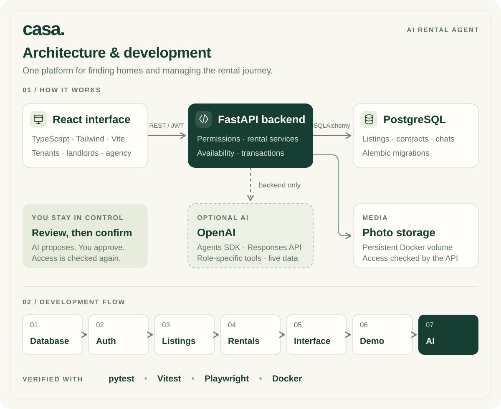

# Architecture

Casa combines a React interface, a FastAPI API and PostgreSQL. The public portfolio uses Vercel and Neon; Docker provides local development and an alternative deployment.

## Application layers

| Layer | Responsibility |
| --- | --- |
| React, TypeScript, Vite | Public search, role dashboards, forms, listing cards and Blu |
| FastAPI routers | Validated inputs and versioned `/api/v1` endpoints |
| Services | Authorization, business rules and transaction boundaries |
| Repositories | Scoped queries and serialization |
| PostgreSQL, SQLAlchemy, Alembic | Persistent records, database constraints and versioned migrations |

The backend never creates tables or seeds data during an API request. Browser requests use a same-origin API route; credentials stay on the server.

## Data and rental rules

Properties belong to landlords and contain rooms or one entire apartment. Each unit has a listing and availability window. Tenants have applications, contracts, visits, saved listings and agency conversations.

- PostgreSQL enforces valid roles, ownership relationships, prices and dates.
- Rental dates use `[start, end)`, allowing consecutive stays.
- A whole-apartment booking blocks its rooms; different rooms can be booked together.
- Contracts require matching approved applications. Services serialize conflicting bookings and retry transaction conflicts.
- Listing publication and application approval belong to the agency.
- Image access follows property/listing permissions. Normal uploads are validated and re-encoded; public demo photos are bundled assets.

Live assistant records use `assistant_threads`, `assistant_messages` and `assistant_actions`. Disposable public-demo state uses separate `demo_visitors` and `demo_rate_buckets` tables.

## Roles and authentication

Tenants see their own rental records; landlords manage their own inventory; agency administrators handle reviews and coordination. Every API route enforces its role and ownership rules.

Normal mode uses hashed passwords and revocable JWT authentication. Public-demo mode provides separate, expiring visitor tokens for the three synthetic personas. These tokens cannot become normal account tokens.

## Public-demo protection

`PUBLIC_DEMO_MODE=true` enables a backend policy that rejects writes before parsing their bodies, except role entry, visitor logout and simulated chat. Registration, account changes, uploads, messaging and rental mutations remain blocked even through direct API calls.

A dataset guard requires the complete reserved synthetic dataset and its image metadata. It fails closed if unrelated records are present. Operators must keep the database fictional.

The simulated assistant uses authorized, deterministic database queries. It creates no rental actions, calls no external model and labels its replies as simulated. See [assistant behavior](assistant.md).

## Temporary state

| Deployment | Session and chat storage |
| --- | --- |
| Vercel / Neon | PostgreSQL state shared across independent processes and cold starts |
| Default Docker demo | Bounded process memory; one backend worker; restart clears visitor state |

Neon state uses visitor-specific rows, row locks, expiration and shared rate limits. Default session/chat lifetimes are 30 minutes. Histories are bounded to three threads, 12 turns per thread and 128 KiB per visitor. Logout invalidates only that visitor.

`backend/vercel_entry.py` enforces demo mode, PostgreSQL state, hidden API docs and no live model integration. SQLAlchemy uses `NullPool` with Neon's pooled endpoint. The restricted `casa_runtime` role can read rental data and write only temporary state.

## Deployment and verification

`vercel.json` routes `/api/*` to FastAPI and other requests to the built frontend, with SPA deep-link fallback. Bundled photos and Blu need no persistent upload service.

The optional [Docker deployment](deployment.md) uses Caddy for HTTPS and persistent PostgreSQL/image volumes. Its configuration is separate from development.

[Development and tests](development.md) · [Vercel/Neon operations](vercel-neon.md)
